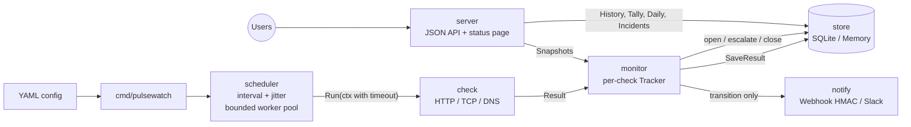
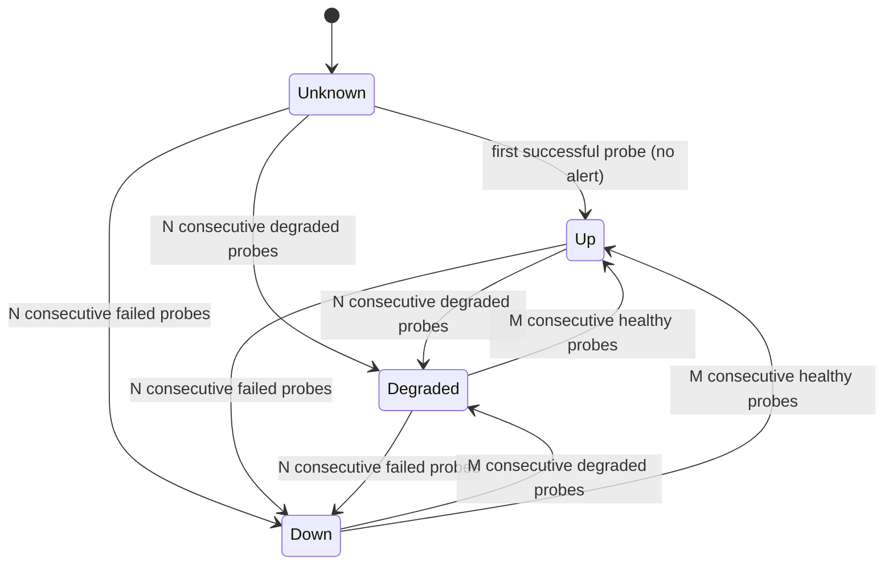

# pulsewatch

A small, self-hosted uptime monitor with a public status page, written in Go.
One static binary, one YAML file, one SQLite database.

pulsewatch probes HTTP(S) endpoints, TCP ports and DNS names on their own
schedules, confirms failures before alerting so a single dropped packet does
not page anyone, records incidents with start, end and duration, and serves a
status page with 90-day uptime bars plus a JSON API.

## Why

Hosted status pages are a monthly bill and another vendor holding your
incident history. Larger self-hosted tools bring a database server, a
frontend build and a plugin system. pulsewatch sits in between: the checks
most teams need, alerting that only fires on real state changes, and nothing
to operate beyond a single process.

## Features

- **Checks**
  - HTTP(S): accepted status range, body substring, latency budget, TLS
    certificate expiry warning, custom method and headers
  - TCP: connection to `host:port`
  - DNS: A/AAAA, CNAME, MX or TXT resolution with an optional expected answer
- **Scheduling**: per-check interval with jitter, a bounded worker pool,
  per-probe context timeouts, at most one run in flight per check
- **State machine** per check (`up`, `degraded`, `down`) with N-consecutive
  confirmation in both directions to suppress flapping
- **Incidents**: opened on the first confirmed bad state, escalated from
  degraded to down, closed on recovery; survive restarts
- **Alerts** on transitions only, with recovery messages that include the
  downtime: signed JSON webhook (HMAC-SHA256) and Slack-compatible webhooks
- **Status page**: server-rendered with `html/template`, embedded CSS, dark
  mode, 90 daily bars per check, recent incidents
- **JSON API** on Go 1.22+ `http.ServeMux` method and wildcard patterns
- Pure-Go SQLite (`modernc.org/sqlite`), so `CGO_ENABLED=0` builds work
  everywhere; `log/slog` JSON logs; graceful shutdown on SIGINT/SIGTERM

## Architecture



| Package | Responsibility |
| --- | --- |
| `internal/check` | Spec and Result types; HTTP, TCP and DNS checkers |
| `internal/scheduler` | Periodic jobs, jitter, worker pool, timeouts, panic recovery |
| `internal/monitor` | `Tracker` state machine, incident lifecycle, alert dispatch |
| `internal/store` | `Store` interface, SQLite and in-memory implementations |
| `internal/notify` | `Notifier` interface, signed webhook, Slack formatter |
| `internal/uptime` | Uptime percentages and daily bar classification |
| `internal/server` | JSON API, status page, embedded templates and CSS |
| `internal/config` | YAML loading, `${ENV}` expansion, defaults, validation |
| `internal/clock` | Injectable clock (real and fake) |

### Check state machine



`N` is `fail_threshold` and `M` is `recover_threshold`. Any probe that matches
the current state resets the streak, so `up, down, up, down` never alerts.
A mixed streak is resolved conservatively: `down, degraded, down` while up
confirms `degraded`, and `up, degraded, up` while down confirms `degraded`.
The transition is timestamped at the first probe of the confirming streak,
which is when the problem actually started.

## Quick start

```bash
git clone https://github.com/asmahdy1420-cmyk/pulsewatch.git
cd pulsewatch
cp pulsewatch.example.yaml pulsewatch.yaml   # edit the checks
make build
./bin/pulsewatch -config pulsewatch.yaml
# open http://localhost:8080
```

With Docker:

```bash
docker build -t pulsewatch .
docker run -d --name pulsewatch -p 8080:8080 \
  -v "$PWD/pulsewatch.yaml:/etc/pulsewatch/pulsewatch.yaml:ro" \
  -v pulsewatch-data:/data \
  -e PULSEWATCH_WEBHOOK_SECRET=change-me \
  pulsewatch
```

Inside the container the working directory is `/data`, so the default
`database: pulsewatch.db` lands on the volume.

Flags: `-config <path>` (default `pulsewatch.yaml`), `-log-level
debug|info|warn|error`, `-version`.

## Configuration

```yaml
listen: ":8080"
database: "pulsewatch.db"     # ":memory:" for an ephemeral run
workers: 8                    # max probes running at once
retention: 90d                # raw results older than this are pruned hourly

status_page:
  title: "Acme status"

defaults:
  interval: 60s
  timeout: 10s
  jitter: 0.1                 # each interval varies by +/-10%
  fail_threshold: 3
  recover_threshold: 2

notifiers:
  - type: webhook
    url: "https://hooks.example.com/pulsewatch"
    secret: "${PULSEWATCH_WEBHOOK_SECRET}"
  - type: slack
    url: "https://hooks.slack.com/services/T000/B000/XXXXXXXX"

checks:
  - id: website
    name: "Website"
    type: http
    target: "https://example.com/"
    interval: 30s
    http:
      expect_status: [200, 299]   # or [204] for an exact code
      body_contains: "Example Domain"
      latency_budget: 800ms       # slower responses are "degraded"
      cert_expiry_warn: 14d       # default 14d; 0s disables

  - id: postgres
    name: "Database"
    type: tcp
    target: "db.internal:5432"
    fail_threshold: 2

  - id: dns
    name: "DNS"
    type: dns
    target: "example.com"
    dns:
      record: A                   # A, AAAA, CNAME, MX or TXT
      expect: "93.184."           # optional substring of an answer
```

Every check can override `interval`, `timeout`, `jitter`, `fail_threshold`
and `recover_threshold`. Unknown keys are rejected, so a typo such as
`intervall` fails at start-up instead of being silently ignored. Durations
accept Go syntax (`30s`, `1h30m`) plus whole days (`90d`).

## API

All endpoints return JSON. Uptime values are percentages, or `null` when there
is no data in the window.

```bash
# All checks with current status, last result and 24h / 7d / 90d uptime
curl -s localhost:8080/api/checks
```

```json
{
  "checks": [
    {
      "id": "website",
      "name": "Website",
      "type": "http",
      "target": "https://example.com/",
      "interval_seconds": 30,
      "status": "up",
      "since": "2026-03-10T09:12:04Z",
      "last_result": {
        "at": "2026-03-10T12:00:31Z",
        "status": "up",
        "latency_ms": 84.512,
        "message": "HTTP 200"
      },
      "uptime": { "24h": 100, "7d": 99.972, "90d": 99.991 }
    }
  ]
}
```

```bash
# One check
curl -s localhost:8080/api/checks/website

# Most recent probe results, newest first (limit 1..1000, default 100)
curl -s 'localhost:8080/api/checks/website/history?limit=20'

# Incidents, newest first; filter by check and/or open state (limit 1..500)
curl -s 'localhost:8080/api/incidents?check=postgres&open=true'
```

```json
{
  "incidents": [
    {
      "id": 12,
      "check_id": "postgres",
      "status": "down",
      "cause": "dial tcp 10.0.0.5:5432: connect: connection refused",
      "started_at": "2026-03-10T11:58:02Z",
      "check_name": "Database",
      "open": true,
      "duration_seconds": 149.3
    }
  ]
}
```

`GET /healthz` returns `{"status":"ok"}` for load balancers. Unknown checks
return `404`; invalid query parameters return `400` with an `error` field.

## Webhook payload and signature

```json
{
  "check_id": "postgres",
  "check_name": "Database",
  "target": "db.internal:5432",
  "from": "down",
  "to": "up",
  "at": "2026-03-10T12:03:10Z",
  "message": "connected",
  "incident_id": 12,
  "summary": "RECOVERED: Database is up again after 5m8s",
  "downtime_seconds": 308
}
```

When a `secret` is set, each request carries:

```
X-Pulsewatch-Timestamp: 1773144190
X-Pulsewatch-Signature: sha256=<hex HMAC-SHA256(secret, timestamp + "." + body)>
```

Receivers should recompute the HMAC over the raw body, compare in constant
time and reject timestamps outside a small window (for example five
minutes) to block replays. `notify.Verify` implements exactly that check.

## Design decisions

- **Confirm before alerting.** Alerts follow confirmed state transitions,
  never individual probes. The thresholds trade detection latency
  (`interval x fail_threshold`) for quiet nights; a separate recovery
  threshold stops a single lucky probe from closing an incident.
- **Degraded is a real state.** A slow response or a certificate about to
  expire is not an outage, but someone should know. Degraded probes count as
  available in uptime percentages and open an incident that escalates if the
  check goes fully down.
- **One run per check, bounded overall.** Each check waits for its previous
  probe to finish before scheduling the next, so a hanging target cannot pile
  up goroutines. The worker pool caps total concurrency; when it is saturated
  checks wait for a slot instead of being dropped. Jitter spreads probes so
  checks configured with the same interval do not fire in lockstep.
- **Interfaces at the edges.** `Store`, `Notifier`, `Checker`, `Resolver` and
  `Clock` are small interfaces. Tests run the same conformance suite against
  SQLite and the in-memory store, use `httptest` servers and real local
  listeners for checkers, and drive the state machine with a fake clock.
- **SQLite without cgo.** `modernc.org/sqlite` keeps cross-compilation and
  distroless images trivial. WAL mode plus a single connection is plenty for
  probe-rate writes. Times are stored as Unix milliseconds and daily uptime
  is aggregated with `GROUP BY at_ms / 86400000` (UTC days).
- **Recording is not cancelled by shutdown.** Probes are cancelled on
  SIGTERM, but saving their result and updating the incident run on a
  detached context so state stays consistent. On start-up, open incidents
  are reloaded so the next healthy streak closes them.
- **Server-rendered status page.** No JavaScript build, no client-side
  fetching. The page refreshes every 60 seconds and works with scripts off.

Deliberately out of scope: user accounts, a configuration UI, multi-region
probing and a plugin system. They would turn a single-binary tool into a
platform.

## Running tests

```bash
make race          # go test -race ./...
make vet           # go vet ./...
make fmt-check     # gofmt -l .
make cover         # coverage summary
```

CI (`.github/workflows/ci.yml`) runs vet, the gofmt check, the race-enabled
test suite and a static build on every push and pull request.

## License

MIT, see [LICENSE](LICENSE).

Author: Ahmed Mahdy
